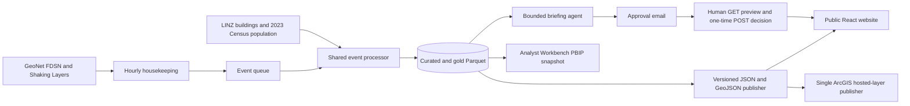

# NZ Hazard Exposure Monitor

**See how many New Zealand buildings and people are exposed to damaging
earthquake shaking, within a one-hour publication target.** The
[live website](https://stnzhem8495b7ca.z8.web.core.windows.net/) serves
catastrophe and exposure analysts who need a traceable first view before
portfolio matching or loss modelling.

The homepage shows recent GeoNet earthquakes; each detail page combines
shaking, H3 exposure cells, MMI-band charts, regional totals and, when a human
has approved it, a written briefing. Ten historical events have a separate
**as-if-today** replay using current buildings and 2023 population. An event
without damaging shaking still receives a clear assessment.

The new Analyst Workbench page at `/workbench` extends the first-hour website
result with threshold changes, repeat regional exposure, historical comparisons
and data health. This page is in an unmerged review PR and is not yet on the
public site. Its five-page PDF is a dated snapshot; the interactive report runs
in Power BI Desktop. See the
[model and refresh guide](docs/powerbi.md).

| Observed result | Evidence |
|---|---|
| Genuine new GeoNet M5.0 event published **32 minutes 9 seconds** after origin on 2 Nov 2026 | [Azure acceptance](evidence/m1-a/azure-acceptance-2026-11-02.md) |
| Azure and local replay data matched across **56 curated/gold Parquet files** (216,680,598 bytes) | [Azure acceptance](evidence/m1-a/azure-acceptance-2026-11-02.md) |
| November month-to-date actual cost: **NZD 0.535918** as reported on 4 Nov NZDT; billing is delayed, so this is not a monthly run rate | [Cost record](docs/cost.md) |

## Architecture



`src/nzhem/core` and the ports are shared by two supported hosts. The local
Docker Compose host uses folders, SQLite, Mailpit and Caddy; the Azure Functions
host uses managed-identity Storage, ACS Email, Key Vault and the Storage static
website. Only Azure currently publishes to the private ArcGIS layer. The browser
uses LINZ LDS topographic tiles with a public tile key and never receives
server-side ArcGIS, OpenAI or approval secrets. See the
[method](docs/methodology.md), [operations runbook](docs/runbook.md) and
[five-minute interview demo script](docs/interview-demo.md).

## Current status

The Azure for Students deployment is live, with no subscription upgrade or
payment method. Its Function processes hourly GeoNet updates and publishes
immutable data generations before switching the public manifest. The first
Azure Kaikōura briefing was approved through the emailed GET confirmation and
POST decision flow and appears on the website. The private ArcGIS item retained
its ID during Azure incremental publication; the 4 Nov check found 4,014
features and 3,521,464 bytes, within the 125 MiB free storage allowance.

Acceptance evidence is under [`evidence/m1-a/`](evidence/m1-a/). The
[owner-assisted record](evidence/m1-a/owner-assisted-acceptance-2026-11-04.md)
documents the poison-queue drill, unchanged gold hashes, TEST-mail rejection
and hourly telemetry. Action Group email delivery remains open; the student
subscription rejected Azure's built-in Action Group test. The NZD 1 drill
budget was removed at the owner's request without a natural stop test. The
revised M5 five-page PBIP, screenshots and PDF passed
review in PR #59. The owner cancelled M5 and M8 video deliverables. M7's
[Snowflake offline preparation](docs/snowflake-benchmark.md) is ready; actual
benchmark measurements wait for a trial account.

## Important limitations

- The system has no insurance policy data. "Exposure" means building count,
  building footprint and population.
- Estimated Modified Mercalli Intensity is illustrative, not an actuarial,
  engineering or emergency-management conclusion.
- Event-time building appearance and disappearance dates are approximate
  inferences from aerial imagery and source lifecycle metadata. As-if-today
  replays do not make an event-time building-stock claim.
- Population is published 2023 SA1 population distributed within each SA1 by
  current building footprint. SA1 is coarser than meshblock and Stats NZ applies
  confidentiality treatment to small-area counts.

## Repository layout

```text
src/nzhem/core/       cloud-independent business logic (no azure.* imports)
src/nzhem/ports/      storage, queue, table, mail, LLM and website contracts
src/nzhem/adapters/   local and Azure implementations
hosts/local/          FastAPI + APScheduler Docker host
hosts/azure_functions Azure Functions trigger bindings
dbt/                  DuckDB/dbt transformation project
infra/bootstrap/      state storage, production resource group and GitHub UAMI
infra/providers/      explicitly approved Azure provider registrations
infra/identity/       retired Entra-application design notes
infra/guardrails/     independent subscription budget root module
infra/terraform/      production Azure infrastructure
scripts/              build and verification tooling
docs/                 method, architecture and operating documentation
evidence/              sanitized milestone evidence
```

## Run the local deployment

The event map uses LINZ Data Service topographic tiles when a public browser key is configured and falls
back to OpenStreetMap otherwise. See [docs/linz-basemaps.md](docs/linz-basemaps.md)
for the key type and setup steps; never use the server-only ArcGIS or OpenAI keys in
the browser.

Requirements: Docker Desktop with Docker Compose v2. No Microsoft account is
needed.

```bash
docker compose up --build
```

The services are then available at:

- API and health: <http://localhost:8000/health>
- Static site: <http://localhost:8080/>
- Token-free historical event map: <http://localhost:8080/map/>
- Mailpit inbox: <http://localhost:8025/>

The application runs `housekeeping` once at startup and then every 60 minutes.
It reads the last successful poll from SQLite and sends GeoNet FDSN an
`updatedafter` query so events published while the computer was off are caught
up. The same run consumes the event queue, prefers an official GeoNet Shaking
Layer, and falls back to the licensed point-source model when no official layer
is ready and the magnitude is within its published range. Every event reaches a
terminal result: ready, outside model range, outside the monitoring window,
timed out or failed after three attempts. Realtime results use event-time
building validity; only the ten fixed historical replays use the as-if-today
baseline. Persistent data lives in the `nzhem-data` and `nzhem-state` Docker
volumes.

Optional local secrets and overrides belong in `.env`:

```bash
cp .env.example .env
```

Never commit `.env`. `OPENAI_API_KEY` is not needed for M1-L housekeeping. The
local ArcGIS publisher defaults to off. Keep `ARCGIS_PUBLISHER_ENABLED=false`
locally when Azure is the active publisher; exactly one deployment may publish.

Stop the services without deleting data:

```bash
docker compose down
```

For the local briefing agent, set a random `APPROVAL_TOKEN_KEY` of at least 32
bytes and `OPENAI_API_KEY` in ignored `.env`. Drafting is available through
`POST /draft-briefing/{event_id}` after the M3/reference Parquet data is in the
local data volume. Review links show a confirmation page on GET and execute
only on POST. Approved pages appear in the static site's briefing list.

The four-tool local MCP server and ten-event evaluation are documented in
[`docs/mcp-local.md`](docs/mcp-local.md) and
[`docs/evaluation.md`](docs/evaluation.md).

Place the untouched owner-created LINZ ZIP at
`.local/data/raw/reference/linz_buildings_export/incoming/lds-nz-building-outlines-all-sources-GPKG.zip`.
The export must be the complete layer in GeoPackage format, EPSG:4326, with no
crop, filter or simplification. Copy it into the persistent data volume and run
the bounded, resumable importer:

```bash
docker compose exec app mkdir -p /data/raw/reference/linz_buildings_export/incoming
docker compose cp .local/data/raw/reference/linz_buildings_export/incoming/lds-nz-building-outlines-all-sources-GPKG.zip app:/data/raw/reference/linz_buildings_export/incoming/
docker compose exec app python scripts/import_linz_export.py
```

The importer validates ZIP paths and declared expansion before extraction, then
uses the GeoPackage RTree to create small national tiles. Each tile loads every
intersecting meshblock regardless of region, so cross-region tiles cannot drop
boundary buildings. It uses one thread, a 512 MB DuckDB limit, a 768 MB process
RSS ceiling, and preserves at least 20 GB free plus a 5 GB work reserve. Verified
tile checkpoints persist in `nzhem-data`, so the same command resumes after a
controlled worker restart. The WFS downloader remains an explicit fallback.

## Azure host local check

The Azure Functions host can be indexed locally without deploying resources.
Install Azure Functions Core Tools v4, create an ignored settings file from the
example, install the host requirements, and start from the host directory:

```bash
cp hosts/azure_functions/local.settings.example.json hosts/azure_functions/local.settings.json
python -m pip install -r hosts/azure_functions/requirements.txt
python -m pip install -e .
cd hosts/azure_functions
PYTHONPATH=../../src func start
```

In PowerShell, use `$env:PYTHONPATH=(Resolve-Path ../../src); func start` for
the final command.

The example uses `NZHEM_ENV=local`; `AzureWebJobsStorage=UseDevelopmentStorage=true`
requires Azurite if trigger storage is requested by Core Tools. This is a local
host check, not evidence of an Azure deployment. Start it with
`docker compose --profile azure-dev up -d azurite`. If ports 10000-10002 are
already occupied, set `AZURITE_BLOB_PORT`, `AZURITE_QUEUE_PORT`, and
`AZURITE_TABLE_PORT`, then put matching explicit endpoints in the ignored
`local.settings.json` connection string.

## Development checks

```bash
python -m pip install -r requirements-dev.txt
ruff check src hosts tests scripts
pytest
python scripts/e2e_replay.py --gold-root tests/fixtures/e2e/gold --manifest tests/fixtures/e2e/manifest.json
sqlfluff lint dbt/models --dialect duckdb
dbt build --project-dir dbt --profiles-dir dbt/profiles --target duckdb_local
```

The parity fixture contains locked real GeoNet Kaikōura and Christchurch M3
summary outputs. CI validates all Terraform roots; it does not apply them.
Azure infrastructure is already deployed. Function packages are currently
published through the owner-authorised Flex Consumption Core Tools path, with
the build SHA, six triggers, managed-identity host storage and next scheduled
site-data generation verified after deployment.

Runtime secrets come from local environment variables, Azure Key Vault, or
Terraform-generated values held in protected remote state and Function app
settings. No long-lived credentials belong in this repository or GitHub CI.

CI also runs `scripts/check_pbip_portability.py`; PBIP sources containing local
drive, UNC, macOS user-home or Linux user-home paths are rejected.

## Data attribution

- Earthquakes and intensity: GeoNet / Earth Sciences New Zealand, CC BY 3.0 NZ.
- Shaking Layers Dataset: Earth Sciences New Zealand, DOI 10.21420/J856-2J84.
- Building outlines: Land Information New Zealand, CC BY 4.0.
- Census and boundaries: Stats NZ, CC BY 4.0. Counts may be randomly rounded or
  suppressed for confidentiality.

## Licence

Project code is licensed under the [MIT License](LICENSE). Third-party data and
generated data products retain their source licences and attribution terms.
