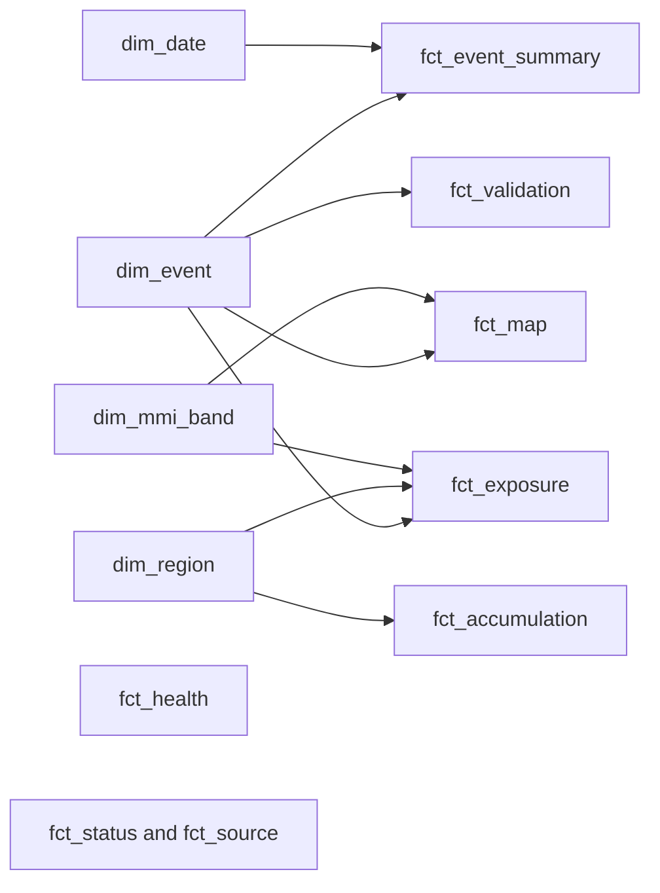

# Analyst Workbench (Power BI Desktop)

The public website answers the first-hour exposure question. Analyst Workbench
uses the same assessed events for threshold changes, replay comparisons,
repeated regional exposure and operational health. The website's Workbench page
shows a reviewed PDF snapshot; the PBIP is the interactive Desktop report. It
is not published to Power BI Service and does not require Microsoft sign-in.

## Shared terminology

| Product term | Meaning | Report implementation |
|---|---|---|
| Buildings at MMI 6+ | Building outlines in cells with Modified Mercalli Intensity at least 6 | `Exposed Buildings` with MMI Threshold 6 (the title follows the selected threshold) |
| People at MMI 6+ | Allocated 2023 population in those cells, rounded to whole people | `Exposed Population` with MMI Threshold 6 |
| Maximum MMI | Maximum populated-cell intensity, one decimal place | `Max MMI`, never summed |
| Historical replay / as-if-today | Fixed earthquake shaking over current buildings and 2023 population | `Event Group = Historical replays`, `Exposure Basis = As-if-today` |
| Live event / event time | GeoNet assessment using buildings valid at the event time and 2023 population | `Event Group = Live events`, `Exposure Basis = Event time` |
| No damaging shaking | Assessed maximum MMI below 6 | `Exposure Status` |

The report uses the same natural event display names as the site, including
`Christchurch, Feb 2011` and `Kaikōura`. Source IDs are prefixed `replay:` or
`live:` inside the model to keep the two assessment bases distinct, but keys are
hidden from report readers. The source GeoNet ID is also retained as a hidden
identity: Event History counts 29 unique earthquakes across 30 assessment
records. Taumarunui appears once in the unfiltered chronology, using the
historical replay. Selecting Live events or Historical replays still exposes
the corresponding assessment. Historical Event Comparison remains limited to the
ten fixed replays. The live public feed contains national MMI-band totals, not
live region-by-band facts; live maps show an epicentre marker and regional
attribution is not inferred. A live national row has no stock denominator, so
regional share is blank for it.

The MMI Threshold control defaults to 6 and changes event exposure cards,
rankings, table titles and history bubble sizes; the fixed repeat-exposure
mart and damaging-event count retain an explicit MMI 6+ label. Zero-exposure
events remain in the comparison table, while ranking bars show only positive
values. Regional tables show only mapped areas with positive event or repeat
exposure; the internal live national row is excluded.

## Model



Relationships are single direction from dimensions to facts. The event summary
contains event magnitude, maximum MMI and MMI 6+ national totals; exposure is
the event-region-MMI-band fact used by the threshold parameter. Map and
validation facts support the offline spatial view and station quality metric.
Accumulation counts repeat exposure across ten replays. Health, status and
source facts are read-only operational snapshots and have no event relationship.
Regional building stock and exposure use the same H3 cell-majority area
assignment. This can differ slightly from counts taken directly from exact
administrative boundaries; the shared assignment keeps district numerators and
denominators comparable. The percentage measure removes visual row filters from
the stock denominator, then reapplies the selected region or authority. Its
matrix total uses the full national stock, including hidden zero-exposure areas.
The date dimension is marked as a date table. Keys and raw numeric columns are
hidden; implicit measures are discouraged.

The main DAX measures are:

```dax
Exposed Buildings =
VAR threshold = [MMI Threshold Selected]
RETURN COALESCE(
    CALCULATE(SUM(fct_exposure[Buildings]),
        KEEPFILTERS(fct_exposure[Band Key] >= threshold)), 0)

% Region Buildings Exposed =
IF(HASONEVALUE(dim_event[Event ID]),
    VAR region = SELECTEDVALUE(dim_region[Region])
    VAR authority = SELECTEDVALUE(dim_region[Territorial Authority])
    VAR stock = SWITCH(TRUE(),
        ISINSCOPE(dim_region[Territorial Authority]),
            CALCULATE(SUM(dim_region[Region Buildings]), REMOVEFILTERS(dim_region),
                dim_region[Region] = region, dim_region[Territorial Authority] = authority),
        HASONEVALUE(dim_region[Region]),
            CALCULATE(SUM(dim_region[Region Buildings]), REMOVEFILTERS(dim_region),
                dim_region[Region] = region),
        CALCULATE(SUM(dim_region[Region Buildings]), REMOVEFILTERS(dim_region)))
    RETURN DIVIDE([Exposed Buildings], stock))

Estimated MMI MAE =
DIVIDE(SUM(fct_validation[Absolute Error]), COUNTROWS(fct_validation))
```

The share denominator is available for replay regions, not for live national
totals. MAE is calculated across valid stations; summing event MAEs would be
incorrect. The report has an explicit `Canterbury Analyst` RLS role filtering
`dim_region[Region]` to `Canterbury Region`; that dimension filters exposure
and accumulation facts. National event summary and data health remain visible.
The default report is unrestricted. In Desktop use **Modeling > View as >
Canterbury Analyst** to test the role, then turn View as off.

## Refresh

From the repository root after the owner has completed an MFA `az login`, run:

```powershell
.\.venv\Scripts\python.exe scripts/build_powerbi_snapshot.py --azure
.\.venv\Scripts\python.exe scripts/check_powerbi_snapshot.py
.\.venv\Scripts\python.exe scripts/build_powerbi_project.py
.\.venv\Scripts\python.exe scripts/prepare_powerbi_desktop.py --name powerbi-desktop-workbench
```

The `--azure` step reads gold blobs, housekeeping runs, poison queue depth,
the public event index and the published housekeeping completion heartbeat.
The Data Health last-success timestamp uses that heartbeat because a polling
run can be recorded as successful before a later site-publication failure.
If the heartbeat is missing, the snapshot refresh fails instead of reporting
a misleading successful time. The step does not change Azure. Open the ignored
`.local/powerbi-desktop-workbench/nzhem.pbip` in Desktop and choose **Refresh**.
The source PBIP uses a relative `RepoRoot`; only the ignored Desktop copy gets
the machine path. Never save a machine path into the committed PBIP. Run
`scripts/check_pbip_portability.py` before committing.

The snapshot builder limits DuckDB to 512 MB, one thread and a 20 GiB C-drive
free-space floor. Data Health reports values at snapshot time, not live values.
The PDF is a fixed, dated export. Power BI Service is intentionally excluded:
Desktop needs no service account, keeps the local Parquet snapshot private and
avoids a second public deployment with separate refresh and access controls.
